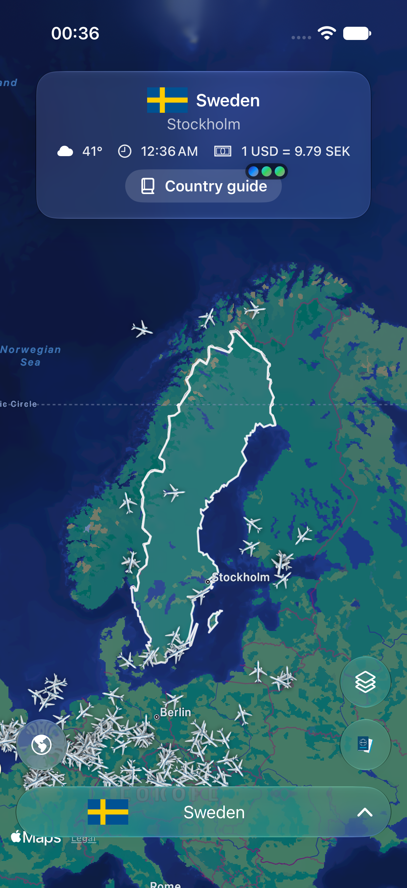
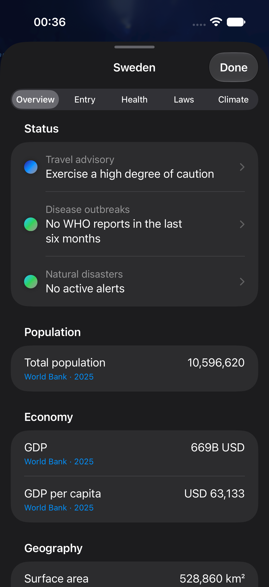

# Tellus


Tellus is a world map and travel guide for iPhone and iPad, built with SwiftUI and Apple MapKit. Explore countries, follow aircraft, trace submarine cables, and see which side of Earth is in darkness.

**Quick start.** Install Xcode 26 or later with the iOS SDK. Open `Tellus.xcodeproj`, select the **Tellus** scheme and an iPhone or iPad simulator, then choose **Product → Run**. Tellus supports iOS and iPadOS 17.5 or later.

<p>
  
  
</p>

## Explore a country

Tellus starts on a random country. Tap a country on the map, search for it in the country picker, or jump to a neighbouring country from its guide. The map outlines the selected country and zooms to fit it.

The country card shows weather and local time at the capital, exchange rates, and relevant alerts. The **Country guide** has five tabs.

- **Overview** shows population, economy, geography, and infrastructure figures alongside recent events. Each figure includes its observation year and a link to its source. Open **Electricity profile** under **Energy** to see domestic generation by source and net electricity trade for the latest available year. The tab also covers the forecast, exchange rates, connectivity disruptions, emergency numbers, and neighbouring countries.
- **Entry** covers entry advice and visa requirements for the passport selected in Tellus.
- **Health** covers health advice and WHO outbreak reports.
- **Laws** covers local laws and culture.
- **Climate** covers climate and natural hazards, including active disaster alerts.

The passport picker saves your choice on the device. It sets the passport used for visa lookups and the preferred home currency. Without a passport selection, exchange rates use the device region's currency when available.

Open **Cost of living** under **Prices** to compare household prices with the EU average or another country in Eurostat's dataset. Tellus uses the latest year with an overall index for both places and shows the breakdown for that same year where available. The figures compare national price levels for food and non-alcoholic drinks, housing and utilities, transport, and restaurants and accommodation. Eurostat's detailed coverage is primarily European. [Eurostat price level data](https://ec.europa.eu/eurostat/databrowser/view/prc_ppp_ind_1/default/table?lang=en)

## Map layers

Open **Map layers** to enable or disable each layer. Tellus remembers the settings on the device.

| Layer | What it shows | Default |
| --- | --- | --- |
| **Live flights** | Aircraft in the visible map area, including military traffic. Tap an aircraft for available flight telemetry, registration, aircraft photo, and route details. | On |
| **Natural hazards** | Earthquakes, tropical cyclones and their tracks, floods, wildfires, droughts, and volcanic eruptions. Tap a marker for details. | On |
| **Undersea cables** | Submarine cable routes and landing points. Tap a cable to see its details and source link. | Off |
| **Power grid** | Mapped power lines, substations, and power plants. Zoom in and tap a feature to see available details and open its OpenStreetMap record. | Off |
| **GPS interference** | Daily GPSJAM cells with elevated or high reports of low aircraft navigation accuracy. Choose a recent UTC day and tap a shaded cell for counts and the source. | Off |
| **Earth at night** | A moving shade over the night hemisphere and a transparent overlay from the latest available daily NOAA-20 Black Marble nighttime imagery. | Off |
| **Aurora forecast** | NOAA's short-term aurora forecast for both hemispheres, with an intensity legend and the forecast's valid time in UTC. | Off |
| **VIIRS true colour** | Recent NOAA-21 satellite imagery. Starts on the latest date NASA GIBS lists, with a choice of available dates from the past seven UTC days. | Off |

The flight layer polls about every 15 seconds while the map is settled and backs off when OpenSky rate-limits requests. At wide zoom levels, Tellus draws up to 500 aircraft. The natural hazards layer refreshes every 15 minutes while the map is open.

### GPS interference

Tellus fetches GPSJAM’s daily CSV directly when the layer is enabled. It opens on the latest available completed UTC day and lets you select from the previous seven days. Amber and red use GPSJAM’s adjusted thresholds of 2–10% and over 10%, with a minimum of five sampled aircraft per cell. Shading represents reports of degraded aircraft navigation accuracy. Unshaded areas can include sparse or absent ADS-B coverage. [GPSJAM methodology](https://gpsjam.org/faq)

### Earth at night

Tellus calculates the day–night boundary on the device from the current time and updates the shade once a minute. The boundary calculation works offline.

When the layer is enabled, Tellus asks NASA GIBS for the latest available UTC date of its daily NOAA-20 Black Marble imagery. MapKit fetches the visible PNG tiles over HTTPS at native zoom levels 0–8, and Tellus renders the grayscale light measurements as a transparent overlay. Some pixels use older observations to fill gaps. Uncached tiles require an internet connection. [NASA Black Marble daily product](https://ladsweb.modaps.eosdis.nasa.gov/missions-and-measurements/products/VJ146A2) · [GIBS tile documentation](https://nasa-gibs.github.io/gibs-api-docs/access-basics/)

**VIIRS true colour** uses the separate `VIIRS_NOAA21_CorrectedReflectance_TrueColor` layer at native zoom levels 0–9. It shows the observation date in UTC. The newest date may have gaps while satellite passes are still being processed. [NOAA-21 VIIRS layer metadata](https://gibs.earthdata.nasa.gov/layer-metadata/v1.0/VIIRS_NOAA21_CorrectedReflectance_TrueColor.json)

### Aurora forecast

Tellus fetches the latest OVATION forecast from NOAA when the layer is enabled and checks every five minutes while the app is active. The last successful forecast stays visible if a refresh fails. Tellus labels it as older once it is 30 minutes past its valid time. Enable **Earth at night** alongside it to see which regions are in darkness. Viewing conditions also depend on clouds and local light. [NOAA aurora forecast](https://www.spaceweather.gov/products/aurora-30-minute-forecast)

## Run locally

- To run on a physical device, select your development team under **Signing & Capabilities**.
- Controls use Liquid Glass on iOS and iPadOS 26 or later.
- The app calls its data providers directly. Running it requires no API keys or Tellus backend. Country data loads over the network at startup. The country boundary geometry ships with the app.
- Xcode resolves the SwiftyH3 package for the GPS interference layer. [SwiftyH3, Apache 2.0](https://github.com/pawelmajcher/SwiftyH3/tree/0.6.0)

To compile from the repository root without signing:

```sh
xcodebuild -project Tellus.xcodeproj -scheme Tellus -destination 'generic/platform=iOS' CODE_SIGNING_ALLOWED=NO build
```

## Project layout

- Each feature keeps its views, state, services, models, and resources together. The main map brings the country picker, country guide, and map layers together. [Features](Tellus/Features) · [Map](Tellus/Features/Map) · [Country guide](Tellus/Features/CountryGuide) · [Flights](Tellus/Features/Flights)
- The app entry point wires up dependencies. Shared networking and UI code lives under `Shared`. [TellusApp.swift](Tellus/TellusApp.swift) · [Shared](Tellus/Shared)
- Run **Product → Test** on a simulator. Swift Testing unit tests are grouped by feature, and UI automation and launch performance tests use XCTest. [Unit tests](TellusTests/Features) · [UI tests](TellusUITests)
- CI runs SwiftLint on the app and test targets and fails on new violations. To run the same check locally, install SwiftLint 0.65.1 and run `swiftlint lint --strict` from the repository root. The checked-in baseline records existing violations. [SwiftLint release](https://github.com/realm/SwiftLint/releases/tag/0.65.1) · [Lint configuration](.swiftlint.yml)
- CI uses the Swift package versions recorded in `Package.resolved`. On pull requests and pushes to `main`, the GitHub Actions run summary shows app line coverage and provides a downloadable JSON report. Failed runs include the Xcode test result bundle when available. [Test workflow](.github/workflows/tests.yml)

### Rebuild the country boundaries

Download the two inputs. [Natural Earth 1:50m country GeoJSON](https://github.com/nvkelso/natural-earth-vector/blob/master/geojson/ne_50m_admin_0_countries.geojson) · [Country metadata JSON](https://cdn.jsdelivr.net/gh/mledoze/countries@master/countries.json)

Run the script from the repository root with Python 3. It matches boundaries to the app's three-letter country codes and regenerates the bundled resource. [country-borders.geojson](Tellus/Features/Countries/Resources/country-borders.geojson)

```sh
python3 scripts/build_country_borders.py ne_50m_admin_0_countries.geojson countries.json
```

## Data sources and credits

| Data | Provider |
| --- | --- |
| Basemap | Apple MapKit |
| Country metadata, boundaries, and flags | [mledoze/countries](https://github.com/mledoze/countries), [Natural Earth](https://www.naturalearthdata.com/), and [Flagcdn](https://flagcdn.com/) |
| Country profile figures | [World Bank World Development Indicators](https://datatopics.worldbank.org/world-development-indicators/) |
| Household price level comparisons | [Eurostat purchasing power parities and price level indices](https://ec.europa.eu/eurostat/databrowser/view/prc_ppp_ind_1/default/table?lang=en) |
| Electricity generation mix and net trade | [Ember Yearly Electricity Data](https://ember-energy.org/data/yearly-electricity-data/), CC BY 4.0. Tellus downloads the public CSV when a profile is opened and caches the latest country observations for seven days. |
| Travel advisories and destination guidance | [Government of Canada Travel Advice and Advisories](https://travel.gc.ca/travelling/advisories) |
| Passport-based visa requirements | [Passport Index dataset](https://github.com/ilyankou/passport-index-dataset), served through jsDelivr |
| Capital weather and geocoding | [Open-Meteo](https://open-meteo.com/) |
| Exchange rates | [Fawaz Ahmed's Currency API](https://github.com/fawazahmed0/exchange-api) |
| Recent country events | Wikipedia's year-by-country articles |
| Internet disruptions and disease outbreaks | [IODA](https://ioda.inetintel.cc.gatech.edu/) and [WHO Disease Outbreak News](https://www.who.int/emergencies/disease-outbreak-news) |
| Disaster alerts, earthquakes, and eruptions | [GDACS](https://www.gdacs.org/), [USGS Earthquake Hazards Program](https://earthquake.usgs.gov/earthquakes/feed/), and the [Smithsonian Global Volcanism Program](https://volcano.si.edu/) |
| Aircraft positions | [OpenSky Network](https://opensky-network.org/) and [adsb.lol](https://www.adsb.lol/) |
| Aircraft registration, routes, and photos | [adsbdb](https://www.adsbdb.com/) and [Airport-Data.com](https://www.airport-data.com/) |
| Submarine cables and landing points | [TeleGeography Submarine Cable Map](https://www.submarinecablemap.com/) |
| Power lines, substations, and plants | [Open Infrastructure Map vector tiles](https://openinframap.org/about). Data © [OpenStreetMap contributors](https://www.openstreetmap.org/copyright), ODbL. |
| Aircraft navigation accuracy by area | [GPSJAM](https://gpsjam.org/about), based on reports from airplanes.live and ADS-B Exchange |
| Day–night boundary | [U.S. Naval Observatory solar position calculation](https://aa.usno.navy.mil/faq/sun_approx) |
| Black Marble night lights | [NASA Global Imagery Browse Services (GIBS)](https://nasa-gibs.github.io/gibs-api-docs/), part of NASA's Earth Science Data and Information System (ESDIS) |
| Aurora forecast grid | [NOAA Space Weather Prediction Center](https://www.spaceweather.gov/products/aurora-30-minute-forecast), OVATION model |

Coverage and update times vary by provider. When a destination guide is available, it links to the full Government of Canada advisory.
